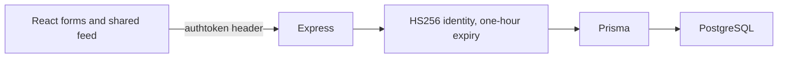

# Fieldnotes: shared blog feed

A small full-stack text-publishing exercise: React/Material UI account forms and a shared post feed, backed by Express, Prisma, and PostgreSQL. Signed-in users can read every post and create new ones. There is no private workspace, post editing/deletion, comments, or publishing workflow.


The screenshot uses intercepted synthetic responses, not a live account or database. [Mobile view](docs/blog-mobile.png) shows the same two sample notes. The interface replaces the generic logo, explains the feed, and shows loading, empty, and error states. Cards are readable articles rather than inert clickable buttons.

## Repository boundaries

`blogs-server-main/` and `blogs-web-main/` are separate packages with different lock formats. The root `concurrently` helper is optional; running each package in its own terminal avoids a third install. This monorepo overlaps the separate blog API/reader repositories and should not be presented as three independent portfolio achievements.

The original setup named [SamCarter01/blogs](https://github.com/SamCarter01/blogs), while the server originated with the linked blogs-server project. That source context and existing license notices are retained; these changes do not claim original authorship of the exercise.



## Local setup

Use Node.js 22, Yarn 1 for the web lock, and a local PostgreSQL database. No global Prisma installation is required.

```sh
cd blogs-server-main
npm ci --ignore-scripts
cp .env.example .env
npx prisma generate
```

Fill the private database URL and a random `JWT_KEY` of at least 32 characters. Set `REACT_APP_URL=http://localhost:3000`. Deliberately apply migrations to your local database with `npx prisma migrate deploy`, then `npm start`. The server binds to `127.0.0.1:8080`. Optional `npx prisma db seed` writes sample data; inspect it first and use a disposable database. Sample accounts are not deployed credentials. Seed post writes are awaited before disconnecting.

In another terminal:

```sh
cd blogs-web-main
yarn install --frozen-lockfile --ignore-scripts
cp .env.example .env
yarn start
```

The web API URL defaults to `http://localhost:8080/api`; the dev UI runs on `http://localhost:3000`. The server and browser API origins must agree with the CORS setting.

## Account and request behavior

`POST /api/auth/signup` accepts `name`, `email`, `password`; `POST /api/auth/login` returns `payload.authtoken`. Both `GET /api/posts` and `POST /api/posts` require that token in the custom `authtoken` header. A post body is:

```json
{"title":"A useful small idea","content":"A synthetic text-only example."}
```

The server signs and verifies HS256 tokens with one-hour expiry and refuses a missing/short signing key. Generic server errors avoid returning database details. Password hashing/checking remains synchronous bcrypt.

The browser reads the current cookie on each request, including post creation immediately after sign-in; the previous instance captured an old token at module initialization. Cookie presence controls UI navigation, not server authorization. The cookie has a one-hour lifetime and `SameSite=Strict`, with `Secure` enabled on HTTPS. It is still JavaScript-readable because the server does not issue HttpOnly sessions. Sign out removes the local cookie; it does not revoke an already copied token. Forms await requests and handle network failures without dereferencing a missing error response.

## Verification and limits

- Backend: Prisma client generation, TypeScript checking, and two offline token/config test groups pass (`npm run typecheck`, `npm run test:unit`).
- Frontend: eleven existing React tests pass, and the CRA production build passes with its existing toolchain/header-naming warnings.
- Chrome: mocked sign-in, shared feed, fresh token header on create, sign out, failed feed loading, and desktop/390px layouts pass without page errors.

Neither PostgreSQL integration nor native bcrypt execution was performed. The original database-backed Mocha suite was not run, and browser responses were intercepted. Frontend dependencies were installed from the existing Yarn lock; the first npm-ci attempt was inapplicable because that package has no npm lock. No lock format was silently changed.

Before hosting, add rate limits, bounded feed pagination, reliable duplicate-registration handling, a deliberate session/revocation design, and deployment checks. This is a local prototype with a shared feed, not a hardened multi-user publishing service. Existing dependency advisories and the legacy CRA toolchain remain separate deployment work.
